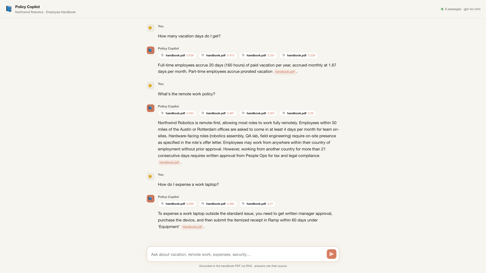

# 📘 Policy Copilot

A small, complete **RAG chatbot** that answers employee questions from a company
handbook PDF — and **only** from that PDF, with a citation for every answer. Built as
the companion project to a build-along course: every file is one idea, in plain code,
no framework hiding the mechanics.

> Company "Northwind Robotics" and its handbook are fictional. Swap in your own PDF and
> it becomes your assistant.

**Live demo:** https://policy-copilot-production.up.railway.app



---

## What it does

You drop a PDF of your policies into `data/`, run one ingest command, and get a chat
UI where employees ask *"how many vacation days do I get?"* and get a grounded,
cited answer. If the handbook doesn't cover the question, it says so instead of
guessing.

## How it works — RAG in three steps

```
        ┌─────────── ingest (once) ───────────┐
 PDF ─▶ extract text ─▶ chunk ─▶ embed ─▶ index.npz
        └──────────────────────────────────────┘

        ┌─────────── per question ────────────┐
 "vacation days?" ─▶ embed ─▶ search index ─▶ top-k chunks
                                                   │
                        paste chunks into prompt ◀─┘
                                   │
                         stream grounded answer ─▶ browser
```

1. **Retrieve** — embed the question, cosine-search the chunk index for the most
   relevant handbook passages. (`app/rag/`)
2. **Augment** — paste those passages into a system prompt that forbids outside
   knowledge and requires citations. (`app/prompts.py`)
3. **Generate** — stream the answer token-by-token over SSE. (`app/main.py`, `app/llm.py`)

## The whole codebase, mapped to concepts

| File | Concept |
|------|---------|
| `app/config.py` | 12-factor config — same code local & on Railway |
| `app/llm.py` | the only provider call: `embed()` + `chat_stream()` |
| `app/rag/ingest.py` | **chunking** with overlap + building the index |
| `app/rag/store.py` | a **vector store** in ~40 lines of NumPy |
| `app/rag/retrieve.py` | **retrieval** + a relevance floor so it can say "I don't know" |
| `app/prompts.py` | **grounding** — turning chunks into a cited prompt |
| `app/main.py` | FastAPI: **streaming** SSE endpoint + static hosting |
| `web/` | Claude-style chat UI, no framework |

## Run it locally

```bash
python -m venv .venv && source .venv/bin/activate
pip install -r requirements.txt
cp .env.example .env          # add your OPENAI_API_KEY

python scripts/make_pdf.py    # generate the sample handbook (or drop your own PDF in data/)
python -m app.rag.ingest      # build data/index.npz
uvicorn app.main:app --reload # http://localhost:8000
```

## Deploy to Railway

The repo is a single service. Point Railway at it, set `OPENAI_API_KEY` in the
**Variables** tab, and it builds from `requirements.txt` + `railway.json`. The
prebuilt `data/index.npz` is committed, so the deploy answers immediately — no
re-embedding on boot.

## Tests

```bash
pip install pytest && pytest        # chunking + vector-store math, no API key needed
```

## License

Apache-2.0. Use it, fork it, ship your own.
